[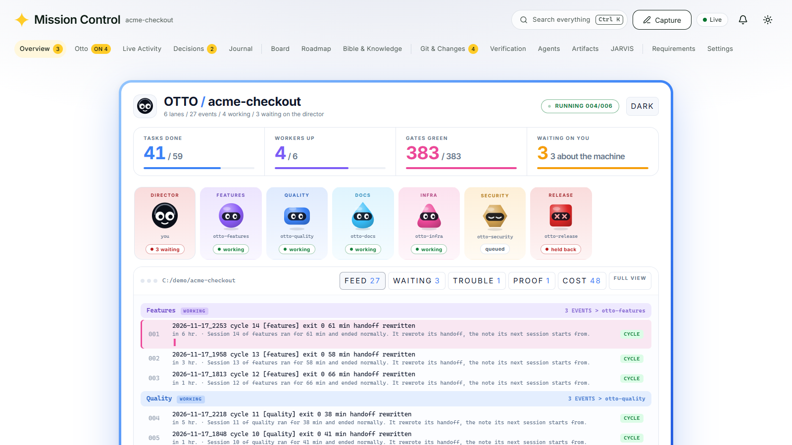](https://tootenramen.github.io/OTTO/)

# OTTO - run AI dev teams for days, and trust what comes back

**OTTO is a universal automation suite for unattended AI development.** It puts a team of agents under rules, locks, a
guard, a supervisor and a kill switch, and makes every session **prove its work** instead of claiming it.
**Mission Control** is the command center that lets you watch all of it, on one screen.

> **Everything on this page is a real recording.** The screenshots and GIFs come from OTTO running in a synthetic demo
> project ("acme-checkout", invented work, real OTTO files). The terminal replays are real command output.
> This repository is the overview. The source code is not published here.
> [Live site](https://tootenramen.github.io/OTTO/) · [More projects](https://github.com/Tootenramen)

## See it move


*The factory board: machine state, tiles for tasks, workers, gates and what waits on you, one card per lane, and a feed
with Waiting, Trouble, Proof and Cost tabs. Light and dark.*


*A tour: Overview, Otto, Live Activity, Decisions, Journal, Git and Verification.*

## Cecilia, live

The factory that runs the sessions is called **Cecilia**. Mission Control's **Otto** view is her live console:
which lane is working, how full each context window is, who holds which checkout, what the supervisor sees, and what has
gone wrong.

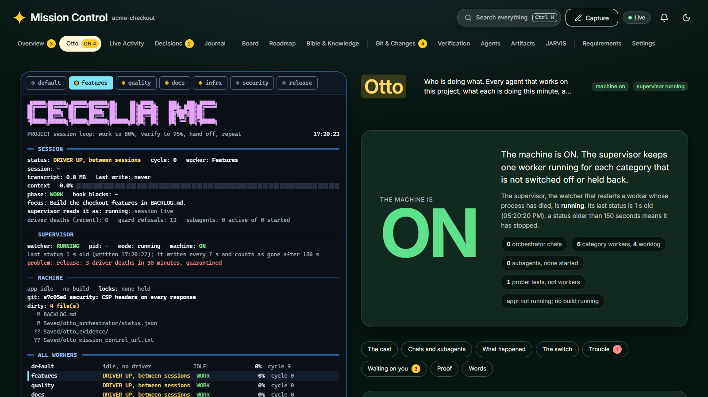

## Mission Control, view by view

| | |
|---|---|
| 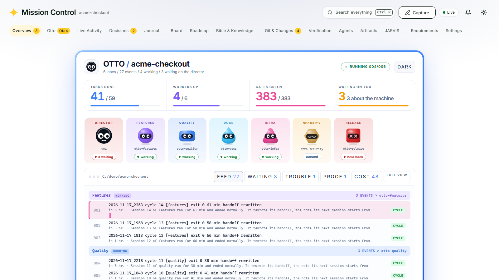 **Overview.** The factory board. What is done, what is running, what waits on you. | 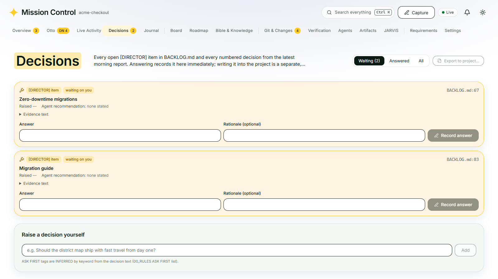 **Decisions.** Everything the agents could not decide, as a short list with a recommendation each. |
| 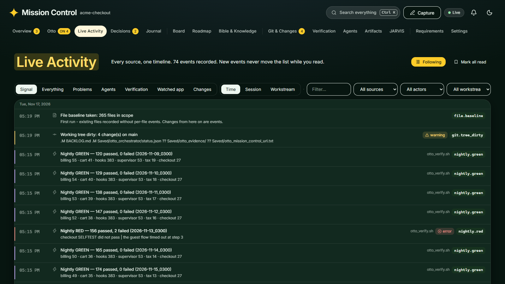 **Live Activity.** A timeline of sessions, commits and nightly runs, GREEN or RED. | 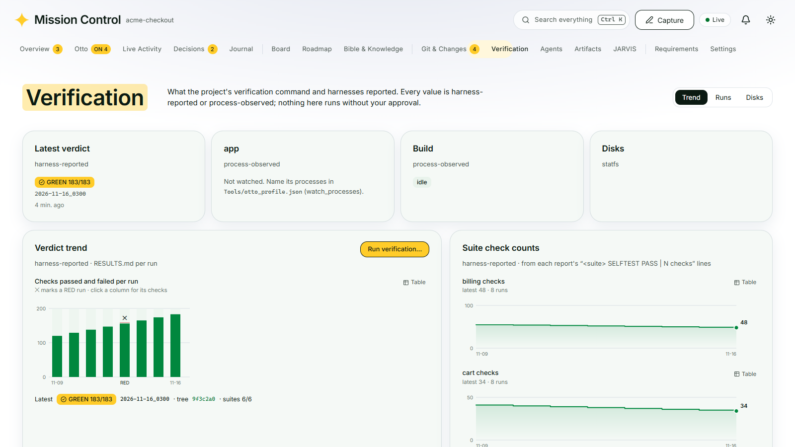 **Verification.** One verdict per run, suite by suite, with the evidence behind it. |
| 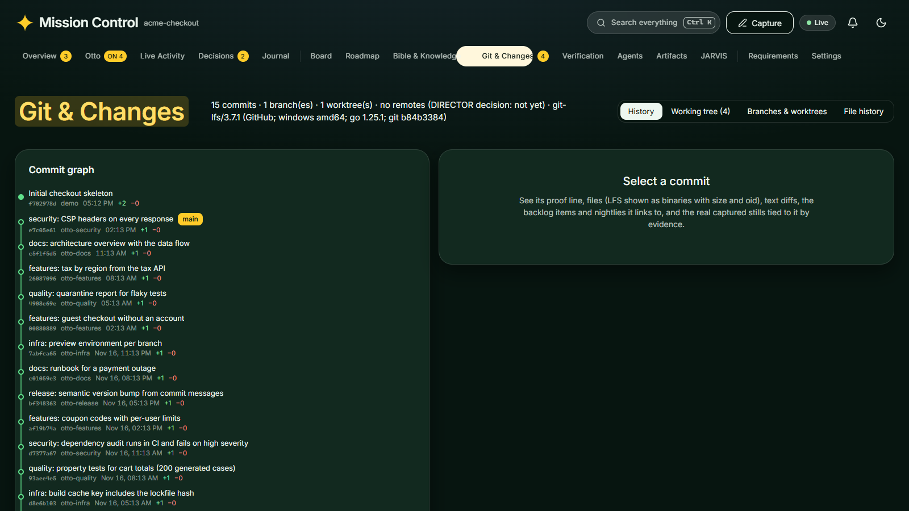 **Git and changes.** The commit graph, who changed what, and the gated write actions. | 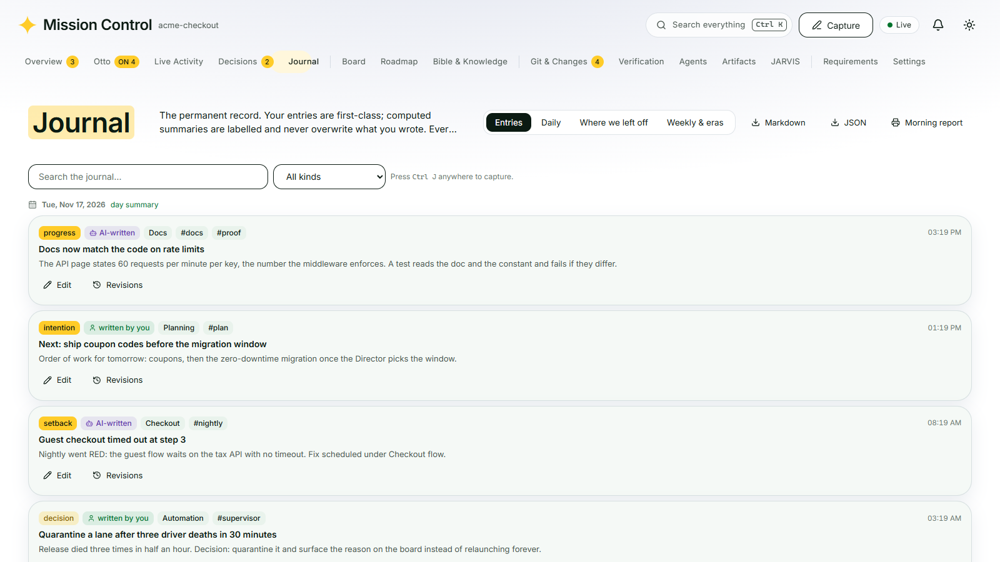 **Journal.** Your notes beside the machine's, searchable (SQLite FTS5). |
| 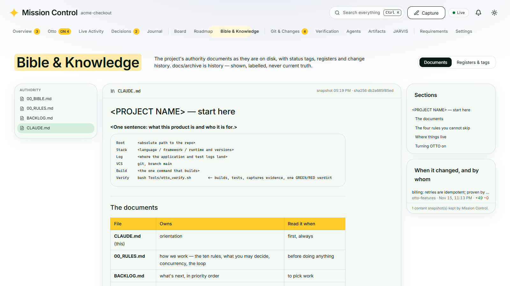 **Bible and knowledge.** The authority documents as they are on disk, with change history. | 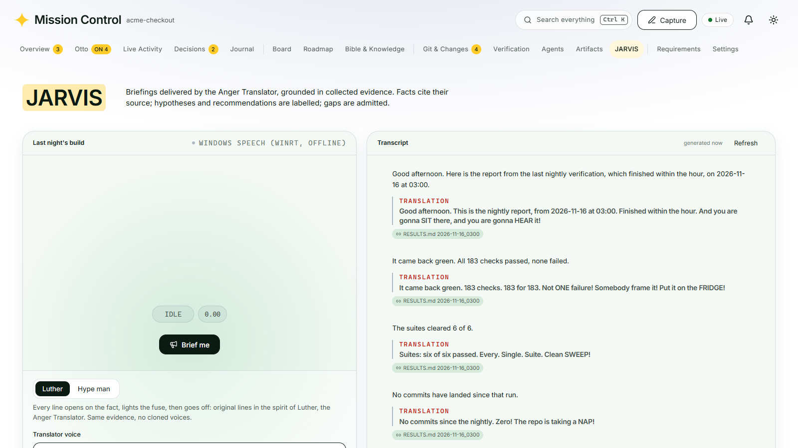 **JARVIS.** A briefing of last night's build, every claim citing its evidence. |

## The nitty gritty: proof you can watch

These are recordings of real runs, not mock-ups.

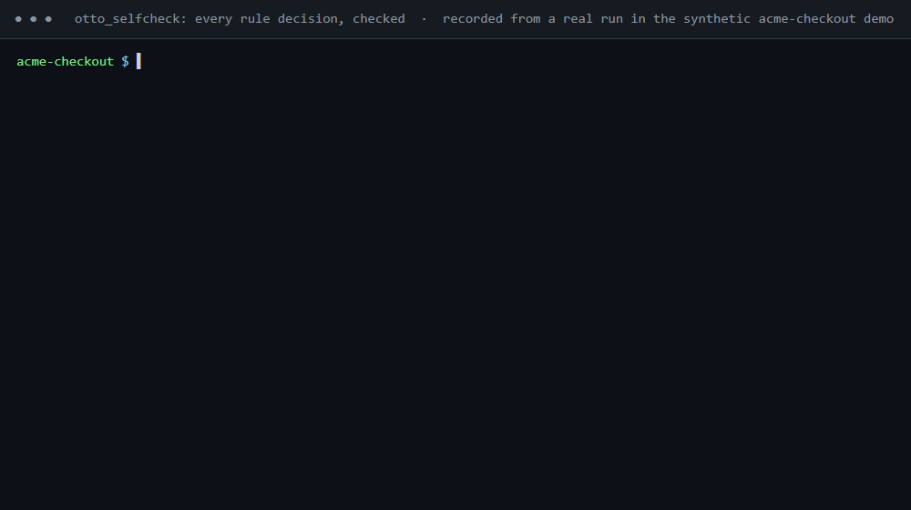

*The selfcheck: guard, stop, pre-tool, subagent, profile and cost decisions. 383 of 383. Refusals included:
another lane's file, no checkout, the control plane, removing the stop marker.*

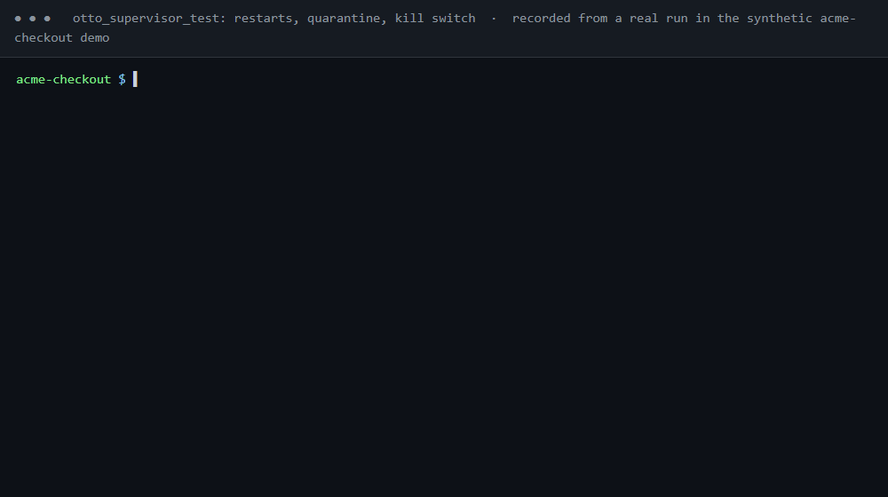

*The supervisor test: relaunch with backoff, quarantine after repeated driver deaths, markers, usage-limit waits. 53 of 53.*

## How it works

1. **A rules file the agents obey.** Decide-don't-ask, six ask-first items, stop conditions, proof or it didn't happen.
2. **Lanes.** READ unlimited, CODE many (each on its own checkout), ASSET exactly 1, BUILD exactly 1.
3. **A structural guard.** A hook outside the agent's control enforces category ownership, own-checkout-before-write,
   lock discipline and bounded delegation, and has its own regression suite.
4. **A handoff loop.** A session works to about 80% of its context, verifies to about 95%, rewrites its own handoff
   prompt, and restarts fresh.
5. **A kill switch.** A single marker file is the machine's off switch. Only the control command removes it, and the
   supervisor restores it if a worker deletes it. The supervisor relaunches dead drivers with backoff, quarantines a
   lane after repeated deaths, and never kills anything.
6. **A proof gate.** One verification command, one verdict, one evidence folder.
7. **A profile.** One file tells OTTO what *your* project launches and builds. Wrong values are ignored and logged,
   never raised.
8. **Cost tracking.** One CSV row per finished session. OTTO ships no prices and will not invent them.

## Origin

OTTO was extracted from the automation behind an **agent-built Unreal Engine game** - about 109k lines of code in 26
days. The factory that ran those sessions, **Cecilia**, worked for days at a time with no end in sight, and Mission
Control was built to watch her run. Every safety feature exists because long unattended runs need it. The engine, game
and project names were then removed so OTTO runs on any project.

## Mission Control facts

Node 24 server + React, Tailwind and Radix. SQLite (WAL + FTS5). **Read-only by default**: every write to the project
is a gated action with a diff, lock checks and a commit, and CSRF protection. A stable port per project in 4720-4799,
its own data directory, a demo mode, and a zero-dependency lite board (`--demo`) for quick looks.

## Directory structure

```
OTTO/
  otto_init.ps1        deploys OTTO into a project, leaves the machine OFF, runs the proof suite
  core/                control command, loop driver, supervisor, governor, rotation, report, cost, live view
  hooks/               the guard, stop hook (context gate + handoff), pre-tool hook, subagent hook
  locks/               per-path checkouts (subtree conflicts both ways) and global locks
  tests/               the 383-decision selfcheck and the 53-check supervisor test, with fixtures
  agents/              implementer and scout subagent definitions
  profiles/            worked examples: node-web, python-service
  dashboard/           Mission Control: Node 24 server + React app, its own tests and docs
  dashboard-lite/      zero-dependency, read-only, localhost-only view
  docs/ examples/ memory/ provenance/
```

## Verified

| Check | Result |
|---|---|
| Hook decisions (guard, stop, pretool, subagent, profile, cost) | 383 / 383 |
| Supervisor recovery (relaunch, backoff, quarantine, markers, usage-limit waits) | 53 / 53 |
| Deploy into empty folders; dry run writes nothing; proof passes in the target | verified |
| Mission Control in a freshly deployed project: type-check, build, tests | 43 / 43 |
| Database upgrade on an existing database, with an automatic backup | verified |
| A week of unattended operation of this exact tree | **not done** |

## Known gaps (honest)

- Never run unattended for a week. The first real run should be one lane, supervised, for a few hours.
- No container isolation. Workers run with permissions bypassed on the host, protected by the hooks.
- Windows-first. The control plane is PowerShell and bash; a POSIX port is the largest missing piece.
- The `claude -p` CLI is the only worker runtime.
- Task intake is one markdown backlog, not a ticket board.
- No agent-quality baseline (error rate, fix-commit ratio) beyond cost.

---
Built by Gustavo Freitas · [LinkedIn](https://www.linkedin.com/in/gustavo-freitas-69b93910b/) · [more projects](https://github.com/Tootenramen)
